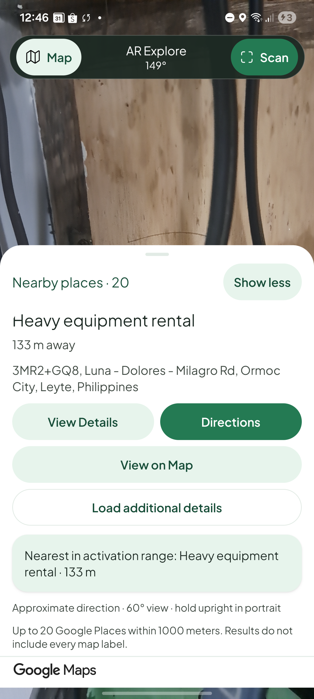
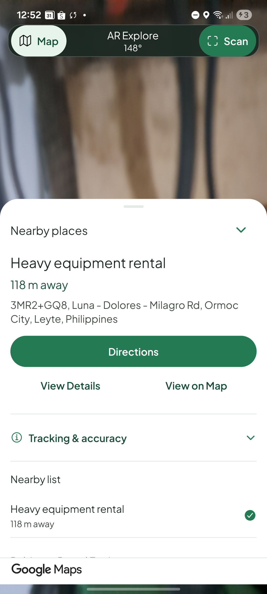
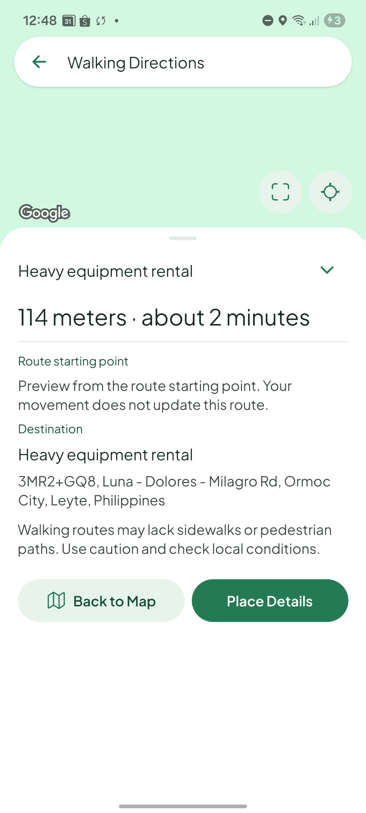
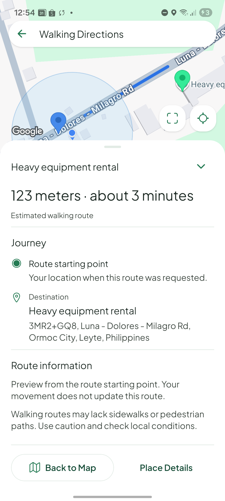
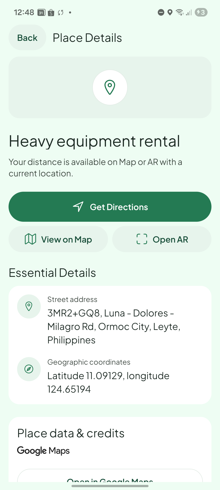
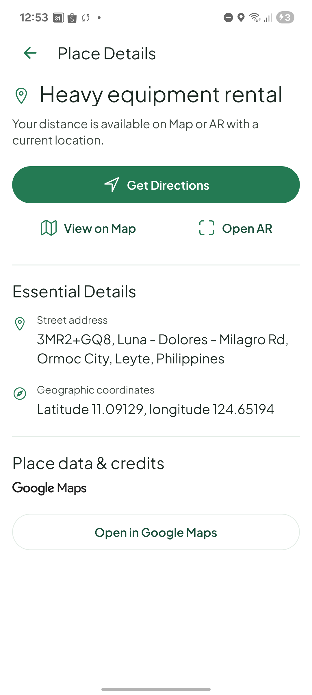
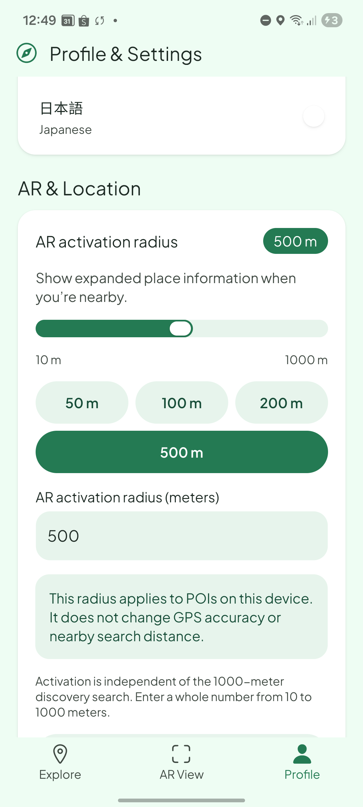
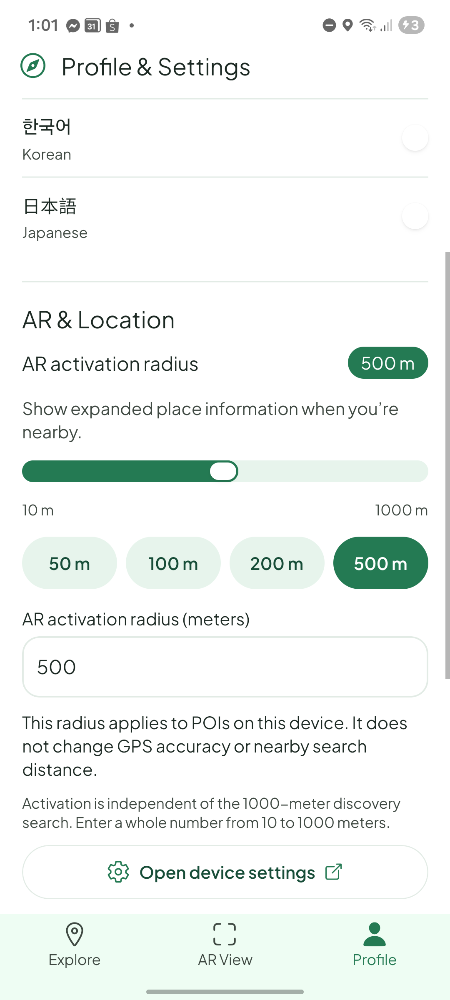

# UI hierarchy refinement — 2026-10-21

Base: freshly fetched `origin/main`, commit `701a225222fb6d148094a617e1c297a2ac4b197e`. Branch: `refine/ui-hierarchy`. Existing uncommitted design references were preserved. The installed development APK was used with the baseline bundle and then this branch's Metro bundle; this batch changes JavaScript/presentation, not native dependencies or backend contracts.

## Investigation and changes

| Area | Confirmed issue | Correction |
| --- | --- | --- |
| AR Explore | Header padding consumed camera space; count/text expansion control and equally weighted actions competed with the destination; repeated guidance pushed the nearby list down. | Tighter header with retained 48 dp actions and contrast; plain Nearby places heading and accessible up/down chevron; compact selected/nearest summary; name, distance, address and primary Directions grouped above subordinate actions. Ordinary technical guidance is disclosed under Tracking & accuracy; failures and recovery remain directly accessible. Nearby rows use dividers and selected indicators. |
| Walking Directions | Tall floating header, low-contrast mint map buttons and an undifferentiated information block. | Compact inset floating header; opaque white Fit/Recenter controls with dark green icons and shadow. Summary includes estimated-route qualification, followed by Journey, Route information, provider warnings/safety guidance and separated actions. Existing scrollable dock, route snapshot, map geometry, padding and attribution paths remain in place. |
| Place Details | Mint page, large generic media box and nested surfaces overwhelmed useful content. Load Details appeared ineffective. | White page, compact fallback icon beside the title, prominent Directions and subordinate Map/AR actions; plain essentials/credits sections. Complete Nearby data no longer offers a redundant paid Details request; genuine recovery has loading, translated success and sanitized error feedback beside the action. |
| Profile & Settings | Mint page and nested cards dominated otherwise functional settings. | White surface, simple section spacing/dividers, radio rows, outline device-settings action and restrained Sign Out. Radius slider, presets, numeric draft, explicit Save and persistence handlers are unchanged; the numeric field retains a visible outline on Android. |
| Home selection | App markers supplied only `Marker.title`, producing default native info windows. | Supported `react-native-maps` custom `Callout` content: rounded white bubble, wrapped Plus Jakarta Sans name and restrained green rule. Pins remain native; provider IDs, selection handlers and independent Home dock remain intact. Native base-map POI taps retain their existing ID-selection path. |

No sensor accuracy thresholds, preference persistence, route fitting policy, paid-request triggers, field masks or app-wide palette were changed. Existing HeroUI controls, UniWind utilities and centralized CSS tokens are reused.

## Load Details root cause

`supabase/functions/_shared/places.ts` requests the same fields for Nearby and Details: ID, display name, location, formatted address, Maps URI and attributions. Both normalize into the same complete discovery display contract. Optional absent fields are valid provider omissions. The old UI treated only a separate Details query as complete, so a valid Nearby result still exposed Load Details.

On the baseline device, pressing Load Details changed the query from pending to success but added **zero display fields**. Only the Maps URI string differed. The button disappeared without a success acknowledgement, leaving otherwise identical visible information. This was a redundant request rather than a suppressed error in the successful reproduction.

The shared cache helper now reuses complete normalized responses only for matching provider ID and known response language. Home, AR, Details and destination-nearby handoffs share that rule and transient retention. Unknown summaries, language changes without matching results and evicted data retain explicit recovery. Disabled observers cannot acquire request authority from cache presence, invalidation, remount or focus. Authentication changes still clear transient results. Keep the documented completeness rule aligned with future backend mask changes.

Regression tests demonstrated the redundant-request failure before the fix. They exercise real screen/query paths with application cache defaults, including focus, foreground return, invalidation/reconnect, remount, expiry, language isolation and destination-nearby navigation handoff. Device request-count telemetry was not retained reliably during USB interruptions; exact call-count claims come from these tests.

## Real location photographs deferred

Actionable ticket: [#19 — genuine place photos with bounded loading and author attribution](https://github.com/mjfelecio/ARgala/issues/19).

Places supports photo metadata and media, but the current masks and client contract contain neither. Genuine imagery requires an authenticated, bounded backend media path, author attribution, expiring photo-resource handling and an explicit loading/cost policy. Photo metadata would not raise the current request's highest Pro tier; media has separate Place Details Photos billing. The ticket records the reviewed pricing, proposed contract, dependencies, failure states and acceptance criteria. No photo API fields, requests, random photographs or generated location imagery were added. Existing approved bundled media and credits remain supported.

## Before/after evidence

Original, unedited captures from the same Galaxy A53 at 1080×2400, 420 dpi override and font scale 1.1. Captures were taken minutes apart with live GPS/provider data: distances, headings, route estimates, map viewport and scroll offset can differ. Directions after shows an explicit Fit; the baseline viewport's missing visible route is not claimed as a new rendering fix. Settings captures exclude the account summary and show the unchanged 500 m preference.

| Screen | Before | After |
| --- | --- | --- |
| AR expanded/header |  |  |
| Directions expanded/header/controls |  |  |
| Place Details |  |  |
| Settings language/radius section |  |  |

[Baseline Load Details control](evidence/ui-hierarchy/details-load-before.png). [Verified custom native marker callout](evidence/ui-hierarchy/callout-after.png). A comparable baseline popup was not successfully captured; the original `Marker.title` implementation establishes its ownership.

## Validation

| Check | Result |
| --- | --- |
| `npm run check` | Passed: strict TypeScript, zero-warning ESLint, **611 tests across 57 files**. |
| Focused regressions | Failing-before/passing-after coverage for hierarchy/disclosure, complete-response reuse, native callout content and known-language destination handoff. Settings/radius suites passed 42 tests across three files. |
| `npm run check:android` | Passed SDK 57 Android configuration and APK profile checks. |
| `npm run check:native-patches` | Passed; installed version-checked patches verified, zero updates on final check. |
| `npm run export:android` | Passed final Metro/Hermes Android export. This is not an APK build. |
| `npm run check:edge` / `npm run lint:edge` | Passed; no Edge source or migrations changed. Limiter-specific suite was not rerun locally. |
| `git diff --check` | Passed. |
| Independent review | Reviewed presentation, query authority, cache retention, provider boundaries and geometry. One destination-nearby language-handoff omission was fixed and covered; follow-up review passed 57 focused tests and reported no further findings. |

### Device checks completed before ADB access ended

Samsung Galaxy A53 SM-A536E, Android 16 / API 36, existing signed-in development APK with configured providers. USB resets intermittently removed port forwarding; work continued offline at the user's request. A later reconnect briefly exposed the launcher, then disconnected before restoring the app connection, so it added no further app acceptance evidence.

- Explicit Search returned 20 real Google places. AR reused them, rendered camera/header, collapsed summary, expanded destination/actions/list and Google attribution. Redundant Load Additional Details was absent for the complete response.
- AR opened the white Details screen with real address/coordinates and credits. Redundant Load Details was absent. Back returned to the AR sheet; this batch did not exhaustively remeasure native CameraX crop transforms.
- An explicit walking action completed a real route (123 m, about three minutes in the after capture). Both dock states and explicit Fit were exercised; route endpoints/geometry and white controls were visible above the expanded dock. The returned route had no provider warnings; warning rendering is covered by tests.
- Return to Home retained selection; native markers appeared after a fresh location sample. Tapping Robinson Rental Equipment displayed the actual styled native callout and its independent Home sheet. Native marker names remained available in the accessibility hierarchy.
- Profile showed white sections. A 50 m preset draft was exercised and restored to 500 m without saving. Final reload confirmed 500 m and the outlined numeric field; Save remained disabled/up to date. Session and persisted language/radius were preserved.

Still unverified for this batch: outdoor GPS/compass accuracy, prolonged camera heat/performance, every navigation/permission timing, full TalkBack operation, other devices/viewport sizes and enlarged text/locales on physical hardware. Automated coverage is not substituted for those checks. Numerical entry, Save failures/recovery and language persistence were covered by existing focused tests rather than repeated live device changes. No standalone refinement APK was built or installed.

## Presentation fallback build

Separately completed [EAS preview build 9195042d](https://expo.dev/accounts/mjfelecios-team/projects/argala/builds/9195042d-b6c4-44e4-9084-b07acd6b4449) from a clean isolated checkout of exact `origin/main` commit `701a225`. It uses the existing preview environment and remote Android signing credentials, producing an internal-distribution APK. It excludes all refinement changes and preserved local design references. EAS reported `FINISHED` at 13:09 Manila; [download the APK](https://expo.dev/artifacts/eas/5NhqYyWy2T2wR8ZZj85kVI6zLh6jjm6T0KRsA7bdPvA.apk). Build completion does not establish APK/device acceptance; this preview has not been installed or exercised in this session.
